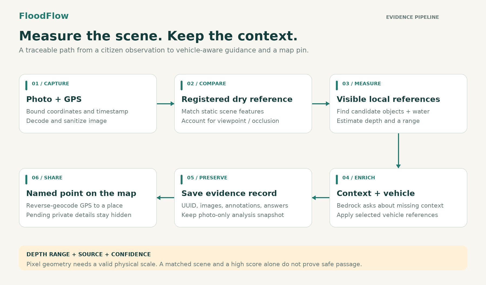
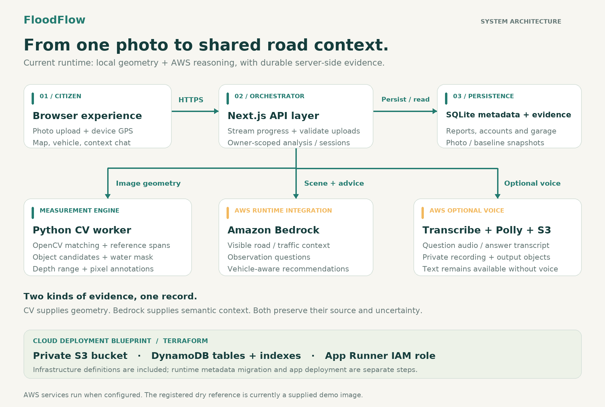

<div align="center">

# FloodFlow

### The same water. A different risk for every vehicle.

**Photo evidence, AWS-powered context, and vehicle-aware waterlogging guidance for Indian roads.**

[](https://www.wemakedevs.org/aws/env)
[](src/lib/aws/bedrock.ts)
[](package.json)
[](tsconfig.json)
[](scripts/cv/)

[Run locally](#run-locally) · [Architecture](#architecture) · [AWS integration](#where-aws-fits) · [Three-minute demo](docs/demo-guide.md) · [Engineering notes](PHOTO_ANALYSIS.md)

**WeMakeDevs × AWS Bharat Builds Tour · Environmental Hacks · Track 02: Heat and Water**

</div>

---

## A flooded road does not tell the whole story

You turn onto a familiar road after heavy rain. A car ahead keeps moving. A scooter has stopped. Water covers the surface, but you cannot see the depth, the potholes, or what it means for your own vehicle.

A single “road flooded” marker misses the decision the driver needs to make.

FloodFlow connects **what someone can see**, **where they are**, and **what they drive**. A citizen uploads a road photo. The system compares it with a registered dry reference, measures usable visual anchors, gathers missing context through a conversation, and presents vehicle-aware guidance. The observation becomes a named point on a shared India map.

The environmental problem is urban monsoon waterlogging. The immediate users are drivers, riders, and people reporting affected streets. The intended benefit is earlier visibility of local conditions and fewer journeys made without relevant evidence. Field impact has not yet been measured.

## What FloodFlow brings together

| Capability | What the user gets |
|---|---|
| **Photo-first reporting** | An upload tied to device GPS, accuracy, and a timestamp; progress is visible while analysis runs. |
| **Dry / wet comparison** | A registered dry reference beside the uploaded image, with reference spans, candidate water boundaries, and optional detailed annotations. |
| **Evidence at a glance** | Estimated depth in millimetres, a range, confidence, road context, visible traffic, and risk indicators when evidence supports them. |
| **Context that asks back** | A separate conversation asks about missing observations; Bedrock-backed questions can refine the evidence record. Voice input/output uses Transcribe and Polly when configured. |
| **Your vehicle, your context** | Cars, scooters, and motorcycles; model and age selection; available sourced specifications; guidance that updates with the selected vehicle. |
| **A remembered garage** | Email/password registration, login, and saved vehicles that can be selected on a later visit. Guests can still use the reporting flow. |
| **Shared road observations** | Saved reports retain an ID and appear as location-named map pins. Private evidence remains owner-scoped while publication is pending. |
| **Journey planning** | A-to-B road alternatives checked against eligible community reports; optional openrouteservice avoidance and OSRM fallback. |



## Run locally

**Web application:** Node.js 20.9+ and npm. **Photo geometry:** Python 3.10+ with the CV dependencies below.

```bash
git clone https://github.com/Nishannt-X/Amazon_Bharat_build_2.git
cd Amazon_Bharat_build_2
npm ci
# Preserve an existing private configuration.
test -f .env.local || cp .env.example .env.local
npm run db:seed
npm run dev
```

Open [the landing page](http://localhost:3000), [report a waterlog](http://localhost:3000/report), or [browse the map](http://localhost:3000/map).

The seed command adds **six labelled sample incidents** across Delhi, Mumbai, Bengaluru, and Chennai. It can be rerun without duplicating them. Samples are excluded from routing hazard checks.

### Enable local computer vision

```bash
python3 -m venv .venv-cv
.venv-cv/bin/python -m pip install -r scripts/cv/requirements.txt
.venv-cv/bin/python -m pip install -r scripts/cv/requirements-references.txt

# Prepare optional model weights before recording; uploads do not download them.
.venv-cv/bin/python scripts/cv/prepare_detector.py
.venv-cv/bin/python scripts/cv/prepare_references.py
.venv-cv/bin/python scripts/cv/prepare_water_model.py
```

Set `CV_PYTHON` and `CV_REFERENCE_PYTHON` in `.env.local` to the **absolute path** of `.venv-cv/bin/python`, then restart the dev server. The base OpenCV pipeline can run without the additional object/reference models; its evidence will be more limited.

Allow location access on localhost or HTTPS. Browsers reuse previously saved permissions, so a prompt does not appear on every visit. Reporting requires an acceptable photo-bound GPS fix; the map can still be explored when precise location is unavailable.

### Review the core experience

1. Open `/report`, allow location access, and upload a waterlogged-road image.
2. Watch analysis progress, inspect the matched dry reference, and toggle detailed measurements.
3. Continue as a guest or sign in; select a vehicle and its age.
4. Review vehicle context and guidance; add observations through **Help in adding context** when needed.
5. Save the report and follow its map link. Register and add a garage vehicle to try the returning-user experience.

Two dry demo references are bundled: a mural underpass and a Delhi street scene at `28.63470286, 77.22210794`. Wet companion images are supplied during the demonstration; a wet result is calculated from the upload rather than loaded from a stored wet-photo result.

## Architecture



The browser sends the image to **Next.js route handlers**, which validate and sanitize it, stream progress, and invoke the **Python CV worker**. OpenCV matches static features; optional object and water models propose reference candidates and water regions. The result retains pixel measurements, alignment diagnostics, limitations, and depth provenance.

**Amazon Bedrock** adds visible scene context, asks targeted observation questions, and supports vehicle-aware recommendations. It complements geometric evidence; an LLM-generated object dimension is not treated as a surveyed measurement. Recommendations keep a deterministic fallback when cloud configuration or inference is unavailable.

The current runtime stores **reports, analysis snapshots, accounts, and garage data in SQLite** on the server. Report metadata and sanitized images are committed together. Each report has a UUID, coordinates, a timestamp, and associated evidence. The map feed exposes a nearby place name resolved from the pin coordinates, while pending photos and detailed analysis remain private. Pending reports and samples are excluded from routing hazard inputs.

See [the architecture reference](docs/architecture.md) for the editable diagram and component boundaries.

## Where AWS fits

| Service | Role | Implementation |
|---|---|---|
| **Amazon Bedrock** | Multimodal scene extraction; observation questions and answers; personalized advisory generation. | [`analysis-engine.ts`](src/lib/analysis-engine.ts), [`aws/bedrock.ts`](src/lib/aws/bedrock.ts), [`vehicle-recommendations.ts`](src/lib/vehicle-recommendations.ts) |
| **Amazon Transcribe** | Converts recorded context answers into text for user review. | [`analysis-voice.ts`](src/lib/analysis-voice.ts), [`/api/analysis/voice`](src/app/api/analysis/voice/route.ts) |
| **Amazon Polly** | Reads the clarification question aloud. | [`analysis-voice.ts`](src/lib/analysis-voice.ts), [`/api/analysis/speech`](src/app/api/analysis/speech/route.ts) |
| **Amazon S3** | Runtime voice recordings and transcription output; additional photo/backup helpers are included. | [`analysis-voice.ts`](src/lib/analysis-voice.ts), [`aws/s3.ts`](src/lib/aws/s3.ts) |
| **Amazon DynamoDB** | Infrastructure definitions for reports, accounts, garage, vehicle data, and analysis profiles, including query indexes. | [`terraform/dynamodb.tf`](terraform/dynamodb.tf) |
| **AWS IAM** | Application role and service-access policy for the cloud deployment blueprint. | [`terraform/iam.tf`](terraform/iam.tf) |

Bedrock and voice integrations execute when configured. DynamoDB is currently an infrastructure definition; the application's metadata stores still use SQLite. The S3 photo helper is available but is not wired into the report-write path. The Terraform directory does not deploy the application service itself.

### Configure the AWS-backed experience

Keep configuration in `.env.local`, which is excluded from Git. Use server-side AWS credentials and a model accessible in the selected region. Never put AWS keys in `NEXT_PUBLIC_*` variables.

| Variable | Purpose |
|---|---|
| `AWS_REGION` | Region for the AWS runtime clients. |
| `BEDROCK_VISION_MODEL_ID` | Model or inference profile used for image scene extraction. |
| `BEDROCK_RECOMMENDATION_MODEL_ID` | Model or inference profile used for vehicle advice. |
| `TRANSCRIBE_BUCKET` | Private S3 bucket for recordings and transcription output. |
| `POLLY_ENABLED` / `POLLY_VOICE_ID` | Enable spoken questions and choose a supported voice. |
| `S3_EVIDENCE_BUCKET` / `S3_REGION` | Configuration for the separate S3 evidence helper. |
| `OPENROUTESERVICE_API_KEY` | Optional rerouting around reported waterlogging buffers. |

Use `GET /api/analysis` to inspect whether vision and voice providers are configured. Configuration flags do not substitute for a successful cloud call. Without AWS configuration, the app retains local analysis, typed observations, and deterministic guidance.

## Built for the judging criteria

The [official judging rubric](https://www.wemakedevs.org/aws/env#judging) evaluates five areas. FloodFlow's demonstration is organized around each one:

| Criterion | Evidence to show |
|---|---|
| **Idea and Impact** | One concrete Indian monsoon problem: the same reported water depth has different implications for different vehicles. |
| **Built on AWS** | Show Bedrock-backed scene/context output and advice. If voice is configured, demonstrate Transcribe and Polly with the associated private S3 objects. |
| **Design and usability** | A map-first report page, photo-led analysis, guest access, a compact context conversation, and a returning user's saved vehicle. |
| **The execution** | Upload an image, inspect measurements, switch vehicle context, save a report, refresh, and reopen its map pin. |
| **The demo video** | A recorded three-minute story connecting the road problem, working flow, and AWS contribution. Follow the [recording guide](docs/demo-guide.md). |

The event's prize eligibility requires an AWS open-source tool or an AWS deployment. A local app calling AWS SDKs should not be presented as proof of application deployment; include the actual hosted URL or qualifying AWS open-source usage in the submitted entry.

## Engineering decisions that matter

- **Geometry and semantics have distinct jobs.** CV supplies spans and candidate boundaries; Bedrock describes visible context and supports the conversation.
- **Perspective is part of the measurement.** A façade match does not establish road-plane alignment. A disappearing curb can be submerged, occluded, or outside the frame; absence alone is not an exact depth.
- **Evidence is retained.** The uploaded image, dry reference snapshot when available, annotations, analysis, context answers, and selected vehicle remain associated with the report.
- **The original photo assessment is preserved.** Context can refine the working assessment without erasing its photo-only snapshot.
- **Private evidence has an owner.** Analysis endpoints and pending report images check ownership. Accounts use password hashing and server-side sessions; guest evidence can be associated with an account.
- **Cloud failure has a defined fallback.** Local geometry, typed context, and deterministic guidance remain available when supported cloud features fail or are unconfigured.

### Measurement scope

The bundled references are demonstration scenes, not a surveyed field dataset. The underpass estimate uses a **250 mm reference-height assumption**; other references may use broad dimension priors. Confidence is not a validated probability of safe passage, and presentation/demo confidence values are stored separately from measured CV evidence. Ground clearance alone is not a wading limit. The Google Street View baseline loading component currently displays a registered reference; live Street View retrieval is not integrated.

## Development and verification

```bash
npx tsc --noEmit
npm run lint
npm run build
npm run test:analysis
npm run test:features
npm run test:shared-reports
npm run test:vehicles
npm run test:navigation
```

Additional test commands cover place search, report grouping, GPS handling, and map recentering; see [`package.json`](package.json). The suites exercise geometry/evidence rules, persistence, ownership boundaries, account and garage behavior, vehicle references, and routing inputs. Local test results are not a field accuracy benchmark.

The application requires a writable persistent directory for its current SQLite stores. The included Dockerfile packages the web runtime; provision Python dependencies and cached model weights separately for a full CV deployment. A stateless multi-instance deployment needs shared storage adapters before replacing the single-server database.

## Repository guide

```text
src/app/                       Landing page, report/map screens, API routes
src/components/                Analysis overlay, context chat, vehicle panel, maps
src/lib/analysis-engine.ts      CV orchestration and Bedrock scene extraction
src/lib/photo-analysis.ts       Evidence, depth, confidence and provenance rules
src/lib/aws/                   Bedrock adapters and S3 helpers
src/lib/analysis-voice.ts       Transcribe and Polly integrations
src/lib/*-store.ts              Report, analysis, account and vehicle persistence
src/data/                      Vehicle catalog and sourced research artifacts
scripts/cv/                    Matching, object references, water segmentation
public/demo/                   Registered dry baseline images
terraform/                     AWS storage resources and application IAM role
docs/                          Architecture, demo guide, research and figures
```

**Further reading:** [CV measurement design](PHOTO_ANALYSIS.md) · [Vehicle coverage](docs/vehicle-coverage.md) · [Vehicle reference research](docs/research/vehicle-oem-physical-specs.md) · [Architecture](docs/architecture.md) · [Demo guide](docs/demo-guide.md)
