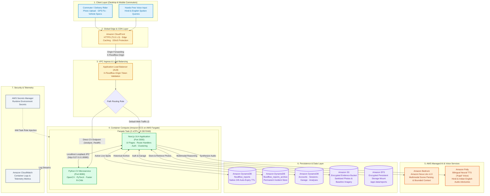
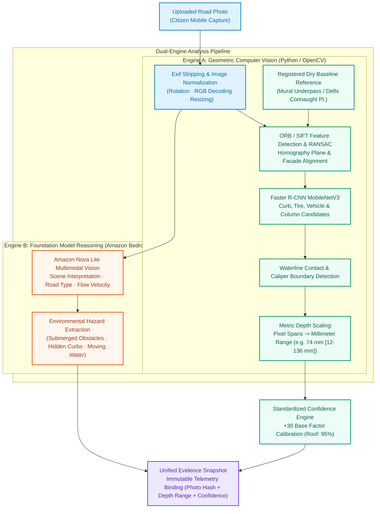
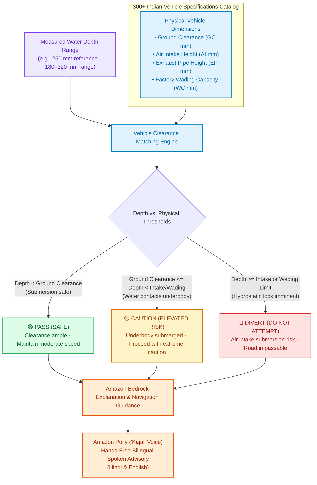
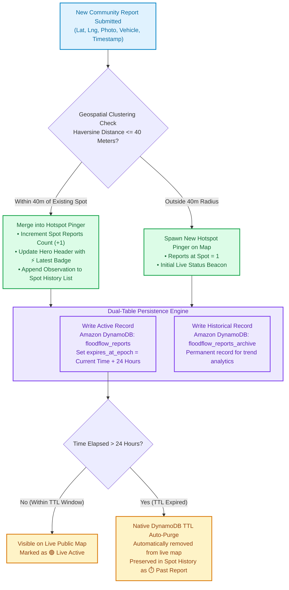

<div align="center">

# 🌊 FloodFlow

**The same road. A different risk for every vehicle.**

**Turn a waterlogged-road photo into evidence, vehicle-aware guidance and a shared map observation.**

[](https://d2encysrkrl5pb.cloudfront.net)
[](https://www.wemakedevs.org/aws/env)
[](package.json)
[](scripts/cv)

**[Open FloodFlow](https://d2encysrkrl5pb.cloudfront.net) · [Report a waterlog](https://d2encysrkrl5pb.cloudfront.net/report) · [Explore the map](https://d2encysrkrl5pb.cloudfront.net/map)**

Built for **WeMakeDevs × AWS Bharat Builds Tour — Environmental Hacks**

Track 02: Heat and Water · Monsoon waterlogging on Indian roads

[The problem](#the-problem) · [What works today](#what-works-today) · [Architecture](#architecture) · [AWS services](#where-aws-fits) · [Run locally](#run-locally) · [Engineering](#engineering-and-verification)

</div>

---

## The problem

It has rained all afternoon. Your usual road is underwater. A car ahead continues; a scooter stops. A map can tell you where the road is, but not what the water means for **your vehicle**.

Waterlogging changes within a street and over time. A binary “flooded / clear” label loses the details that matter: estimated depth, moving water, hidden road surfaces, vehicle context and how recently someone observed the location.

FloodFlow brings those details together. It combines a citizen's **photo and location**, a **dry-reference comparison**, **computer vision**, and **a short conversation** to document the road and give a more useful next step. Other people can inspect that observation on a shared map and compare journeys against reported waterlogging.

The environmental focus is specific: urban monsoon waterlogging in India. The intended impact is better visibility of affected roads, more informed route choices and useful records of recurring hotspots. Field reductions in damage, travel time or emissions have not been measured.

## What works today

| Capability | What it delivers |
| --- | --- |
| **Photo-first reporting** | A map above the report flow, location acquisition, photo upload and a visible analysis stage. A fresh device-location fix is attached to the report. |
| **Automatic image analysis** | Feature alignment, object/reference candidates, water-region analysis, pixel spans and indicative depth in millimetres when the evidence supports a scale. Detailed annotations can be toggled. |
| **Vehicle-aware guidance** | Model, age and optional trim context; available price, clearance and physical references; colour-coded guidance that changes when the selected vehicle changes. |
| **A conversation when evidence is incomplete** | Separate context chat with English and Hindi, editable voice replies, questions about safely observable conditions and bounded score updates. Text remains available throughout. |
| **Accounts and a garage** | Email/password registration, login and saved vehicles for returning users. Guests can use the reporting experience. |
| **A shared India map** | Location-named observations, a device-position marker, sample incidents and report inspection pages. Nearby observations form a hotspot history with active/past counts. |
| **Journey planning** | Start and destination search, road alternatives, report-exposure checks, vehicle/preferences input and a Google Maps navigation handoff. |
| **AWS deployment** | The web app and CV worker run on ECS Fargate behind CloudFront HTTPS, with S3, DynamoDB, Bedrock and Polly integrations. |

**Review the live experience:** upload a photo on `/report`, inspect its evidence, choose a vehicle and add context. Save the waterlog report, inspect its map pin and open its location history. Use `/map` to explore road alternatives.

Location and microphone access require **HTTPS or localhost**. Your browser may reuse a saved permission instead of showing another prompt. You can browse the map without granting precise location; creating an on-site report needs an acceptable GPS fix.

## Architecture



The live deployment uses **one ECS task containing the web and CV containers**. The web container calls the worker over the task's internal network; the worker also has an authenticated cloud endpoint. This keeps Python and model setup off the visitor's device.

Public report metadata and archives use DynamoDB; evidence images use S3. The current application still retains SQLite-backed analysis/session and other server state. **EFS preserves that state across task replacement** while the storage migration continues. This is a single-instance hackathon deployment, not a completed stateless, horizontally scaled backend.

## Where AWS fits

| Service | Responsibility in FloodFlow |
| --- | --- |
| **Amazon ECS + AWS Fargate** | Run the Next.js web runtime and CPU-based CV worker as containers. |
| **Amazon ECR** | Store versioned web and CV images used by the deployment. |
| **Amazon CloudFront + ALB** | Provide the public HTTPS URL and route traffic to the application and worker. |
| **Amazon Bedrock — Nova Lite** | Extract visible scene context, evaluate observation answers and tailor the presentation of vehicle guidance. |
| **Amazon Polly** | Speak context questions in Hindi and English; the current default is the bilingual Kajal neural voice. |
| **Amazon S3** | Store sanitized report photos and associated baseline evidence. |
| **Amazon DynamoDB** | Active reports, report archives, accounts, sessions, garage records and analysis metadata. |
| **Amazon EFS** | Persist the remaining local database and analysis state used by the current runtime. |
| **AWS Secrets Manager + IAM** | Keep provider keys/service tokens server-side and grant the deployed application service access through task roles. |
| **Amazon CloudWatch** | Collect application and worker logs for operational inspection. |
| **AWS CloudFormation** | Provision the deployed networking, compute and hosting resources. |

**Speech input uses Deepgram, not Amazon Transcribe, in the current deployment.** Transcribe code remains an optional adapter; the configured AWS organization blocks that service. Rekognition, SageMaker and Cognito are not part of the active product path.

The DynamoDB configuration separates `floodflow_reports`, `floodflow_reports_archive`, `floodflow_accounts`, `floodflow_sessions`, `floodflow_garage` and `floodflow_analyses`. Community-report activity uses a configurable expiry period. Archived observations remain available for hotspot history; “active” describes the observation's configured lifetime, not a live depth sensor.

## How the evidence engine works



### Geometry before a recommendation

The Python pipeline uses **ORB/SIFT feature matching and RANSAC homography** to compare the uploaded photo with a dry scene. It distinguishes matching a location's facade from establishing a usable measurement plane: identifying the place alone does not prove that an edge can be transferred accurately between viewpoints.

Optional cached models add **Faster R-CNN MobileNetV3** traffic detections, **Grounding DINO** reference-object proposals and **CLIPSeg** water-region candidates. The pipeline retains caliper spans, reference points, matching inliers, image-quality metrics and processing duration. It does not need to download model weights during an upload.

Two dry demonstration references are bundled: a mural underpass and a Delhi street scene near Connaught Place. Wet-image measurements are computed from the uploaded image. The demo references use assumed reference dimensions where surveyed measurements are unavailable. These are indicative geometric estimates, not surveyed ground truth.

### Dry-reference acquisition

The reference-source design connects the report's **latitude and longitude** to the **[Google Street View Static API](https://developers.google.com/maps/documentation/streetview/overview)**. The backend acquisition layer is designed to:

- Check nearby panorama availability through the [metadata endpoint](https://developers.google.com/maps/documentation/streetview/metadata), retaining the panorama location and capture date when available.
- Request a road-facing static image, with heading, field of view and pitch selected to give the CV engine a useful view of the same scene.
- Check scene correspondence and dry-road suitability before using that image as the comparison reference.

Street View imagery is a reference candidate, not proof that the road is dry or that its viewpoint matches the upload. Registered dry references support the current demonstration and provide a controlled fallback when suitable street imagery is unavailable. API credentials belong to the backend; the image's source and available metadata belong with its analysis provenance.

### Context without overwriting the photo

The **Help in adding context** panel is separate from photo analysis. A person can describe body-level water, visible traffic, flow or road visibility from a safe position. Hindi and English voice replies are transcribed for review before submission; the microphone and playback can be stopped, and typing remains available.

Bedrock receives the photo metrics, previous answers and newest observation. The model evaluates how each observation affects the evidence score, with bounded adjustments and a recorded reason. Failed assessments leave the score unchanged. The original photo snapshot stays separate from later context.

The displayed confidence is an **evidence-quality index**, not a calibrated probability of correct depth or safe passage. See the [scoring implementation](src/lib/photo-analysis.ts) and [context assessment](src/lib/context-assessment.ts).

### Vehicle context, not a universal crossing limit

The catalog covers a broad set of vehicle models, with clearance research coverage for every catalog ID. Coverage means a lookup record exists; it does not mean every model, year and trim has complete verified specifications. Research values, manufacturer references and unknown measurements remain distinguishable.

Screening uses the displayed depth estimate, clearance references, vehicle class and reported hazards. Cars and two-wheelers have different rules; moving water, obscured road surfaces and documented vehicle limits can raise concern. Bedrock can explain the result, while server-side rules constrain metrics and action choices. A deterministic recommendation remains available if inference fails.



Ground clearance is **not** an OEM wading limit. Exact intake, exhaust and electrical exposure are used only when relevant documentation exists; the system does not fill missing physical dimensions with LLM guesses.

## From a report to a journey



A saved observation has a **UUID, coordinates, GPS accuracy, time, photo, vehicle context and associated analysis**. Nearby place lookup names the point. Report pages bring together the latest observation, photo inspection, evidence, vehicle information and location history.

The cloud map groups nearby observations into location-based hotspots. Expired observations move out of active classification while remaining in the archive. Six labelled sample incidents make the map explorable before a user submits a report.

Route assessment checks eligible, non-sample reports near entire road segments. It compares exposure across alternatives rather than relying on sparse route vertices. OSRM supplies public driving alternatives; an optional openrouteservice key enables requests with avoidance polygons. The route panel can hand a selected journey to Google Maps.

The route handler excludes samples and records marked pending. The current cloud feed exposes saved observations immediately and normalizes their public status; independent publication moderation remains an engineering priority. A route with no supplied reports is not proof of a clear road, and a public pin is not independent verification of its conditions.

## Run locally

**Recommended:** Node.js 22, npm and Python 3.10+ for local CV. AWS credentials are needed for cloud integrations, not for browsing the local UI and seeded map.

```bash
git clone https://github.com/Nishannt-X/Amazon_Bharat_build_2.git
cd Amazon_Bharat_build_2
npm ci

# Preserve any existing private configuration.
test -f .env.local || cp .env.example .env.local

npm run db:seed
npm run dev
```

Open [localhost:3000](http://localhost:3000), [/report](http://localhost:3000/report) or [/map](http://localhost:3000/map). The seed script adds six sample incidents without duplicating them on repeated runs.

### Prepare computer vision

```bash
python3 -m venv .venv-cv
.venv-cv/bin/python -m pip install -r scripts/cv/requirements.txt
.venv-cv/bin/python -m pip install -r scripts/cv/requirements-references.txt

# One-time downloads; models are cached before the first analysis.
.venv-cv/bin/python scripts/cv/prepare_detector.py
.venv-cv/bin/python scripts/cv/prepare_references.py
.venv-cv/bin/python scripts/cv/prepare_water_model.py

CV_PYTHON="$PWD/.venv-cv/bin/python" \
CV_REFERENCE_PYTHON="$PWD/.venv-cv/bin/python" \
npm run dev
```

Use **your own interpreter path**. A copied path to another developer's machine will not work. The minimal OpenCV install supports base image geometry; the optional model dependencies add semantic and water-region analysis.

The deployed application uses the cloud worker. The local-first/cloud-fallback integration is part of the deployment work; cloud service settings and deployment artifacts must be configured separately from a plain local checkout.

### Configure integrations

Keep secrets in `.env.local` locally and in the deployed secret configuration on AWS. Never prefix server credentials with `NEXT_PUBLIC_`.

| Setting | Purpose |
| --- | --- |
| `AWS_REGION` | Service region; the current deployment uses `ap-southeast-2`. |
| AWS credentials / deployed task role | Access to the configured AWS services. Prefer task roles in deployment. |
| `S3_EVIDENCE_BUCKET`, `S3_REGION` | Evidence storage. |
| `DYNAMODB_*_TABLE` | Names of the existing report, archive, account, session, garage and analysis tables. |
| `BEDROCK_VISION_MODEL_ID` | Scene extraction, currently `amazon.nova-lite-v1:0`. |
| `BEDROCK_RECOMMENDATION_MODEL_ID` | Model used for context and vehicle guidance. |
| `DEEPGRAM_API_KEY` | Server-only Hindi/English voice transcription. |
| `POLLY_VOICE_ID`, `POLLY_SPEECH_RATE` | Speech voice and playback rate; the default voice is Kajal and the rate is configurable. |
| `CV_PYTHON`, `CV_REFERENCE_PYTHON` | Local Python interpreters for geometry and optional reference inference. |
| `OPENROUTESERVICE_API_KEY` | Optional road-routing avoidance support. |
| `REPORT_TTL_HOURS`, `CLUSTER_RADIUS_METERS` | Active-report lifetime and proximity grouping. |
| `REPORT_STORE_DIR` | Writable location for the remaining server-side stores. |

`env.cache` is private deployment metadata and is excluded from Git and container build context. It is not a replacement for a complete AWS deployment configuration. See [voice setup](docs/voice-setup.md) for provider details.

## Engineering and verification

```bash
npx tsc --noEmit
npm run lint
npm run build

npm run test:analysis
npm run test:features
npm run test:shared-reports
npm run test:reports
npm run test:vehicles
npm run test:navigation
npm run test:geolocation
npm run test:recenter
node scripts/run-context-tests.mjs
node scripts/run-voice-tests.mjs
```

Tests cover geometry and calibration inputs, evidence preservation, context boundaries, account/garage isolation, report ownership, vehicle references, report grouping, route exposure, GPS handling and map lifecycle behavior. They verify software rules; they are not a field accuracy benchmark.

Important implementation boundaries:

- **Uploads are decoded and re-encoded.** MIME labels alone are not trusted; photo processing is bounded and saved images lose embedded EXIF metadata.
- **Analysis belongs to a session and photo.** Report creation checks ownership and the uploaded photo's hash against the selected analysis.
- **Photo evidence and context are separate.** Follow-up answers do not replace the original photo-only snapshot.
- **External AI output is constrained.** Confidence deltas are bounded; vehicle metrics and permitted actions remain server-owned.
- **Secrets stay server-side.** Voice-provider keys and worker tokens do not enter the browser bundle.
- **State survives task replacement.** The deployment preserves remaining server state on EFS; existing S3/DynamoDB resources are not recreated for a web release.

The live homepage, report/map/login pages, CV health endpoint and report feed were checked over HTTPS on **12 October 2026**. Deployment health can be inspected at [/api/health](https://d2encysrkrl5pb.cloudfront.net/api/health). Individual cloud inference and routing availability still depend on provider access and service conditions.

## Built for the judging criteria

The [official rubric](https://www.wemakedevs.org/aws/env#judging) prioritizes impact, AWS use, usability, execution and a recorded three-minute demonstration.

| Criterion | Evidence to review |
| --- | --- |
| **Idea and impact** | A concrete Heat and Water problem: Indian monsoon waterlogging, with vehicle context and recurring hotspot observations. |
| **Built on AWS** | A public CloudFront URL, ECS-hosted web/CV runtime, S3/DynamoDB persistence, Bedrock context and Polly speech. |
| **Design and usability** | A map-led, photo-first report experience; a separate context conversation; Hindi/English voice with text fallback; reusable saved vehicles. |
| **Execution** | Running report/map pages, image measurements, vehicle-specific screening, persistence and report history, supported by focused tests. |
| **Demo video** | A three-minute walkthrough can show one upload, its evidence, two vehicle selections, added context and the resulting map observation, with AWS responsibilities visible. |

The next engineering priorities are surveyed reference data, field validation across viewpoints and water conditions, stronger publication moderation, and completion of the stateless storage migration. Broader vehicle documentation and reliable production routing will improve coverage without turning unknown values into invented facts.

## Repository guide

| Path | Responsibility |
| --- | --- |
| [`src/app`](src/app) | Landing, report, map, account and inspection pages; backend route handlers. |
| [`src/components`](src/components) | Map, photo overlay, context conversation, vehicle panel and navigation UI. |
| [`src/lib/analysis-engine.ts`](src/lib/analysis-engine.ts) | Photo processing and CV/Bedrock orchestration. |
| [`src/lib/photo-analysis.ts`](src/lib/photo-analysis.ts) | Measurements, confidence rules, comparison records and evidence provenance. |
| [`src/lib/context-assessment.ts`](src/lib/context-assessment.ts) | Per-answer model assessment and bounded progressive scoring. |
| [`src/lib/vehicle-recommendations.ts`](src/lib/vehicle-recommendations.ts) | Vehicle screening, constrained cloud output and deterministic fallback. |
| [`src/lib/aws`](src/lib/aws) | AWS adapters and cloud report/account/garage operations. |
| [`src/lib/analysis-voice.ts`](src/lib/analysis-voice.ts) · [`src/lib/deepgram-voice.ts`](src/lib/deepgram-voice.ts) | Speech output and transcription adapters. |
| [`src/lib/navigation.ts`](src/lib/navigation.ts) · [`src/lib/navigation-provider.ts`](src/lib/navigation-provider.ts) | Road-route exposure checks and provider integration. |
| [`src/data`](src/data) | Vehicle names, clearance research and physical/OEM evidence. |
| [`scripts/cv`](scripts/cv) | Registration, traffic detection, reference objects, water segmentation and model preparation. |
| [`public/demo`](public/demo) | Bundled demonstration reference assets. |
| [`terraform`](terraform) | Storage/IAM provisioning definitions; separate from the live hosting stack. |

Further reading: [CV design and research](PHOTO_ANALYSIS.md) · [Ground-clearance evidence](docs/research/vehicle-ground-clearance-evidence.md) · [OEM physical references](docs/research/vehicle-oem-physical-specs.md) · [Voice integration](docs/voice-setup.md).
