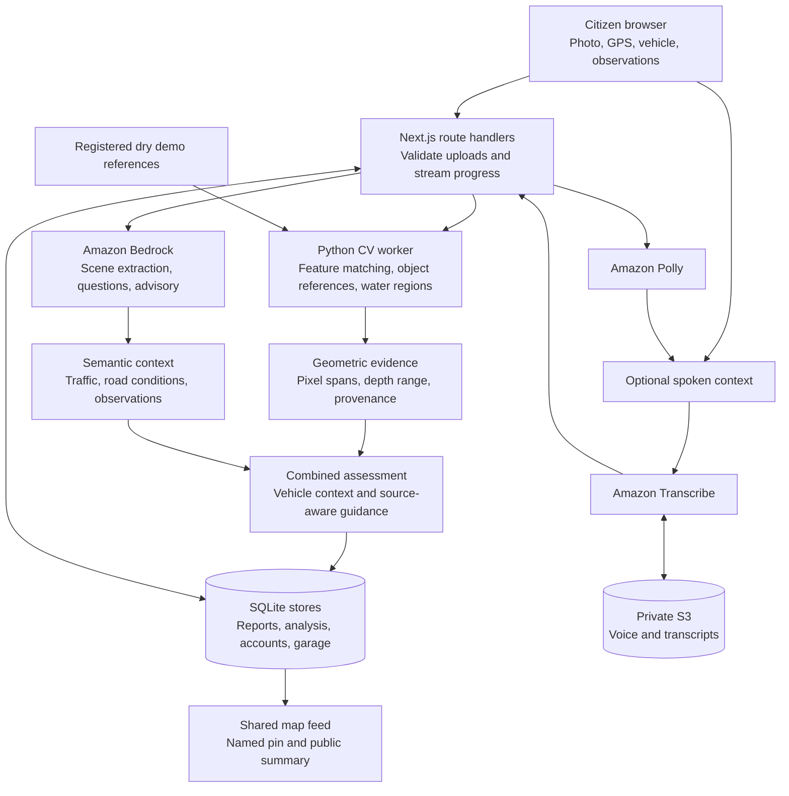

# FloodFlow architecture


## Runtime boundaries



The arrows describe application responsibilities, not a claim that every optional provider is configured in a given checkout. All AWS calls originate on the server. The currently selected reference comes from bundled dry images, selected by visual scene matching.

## Measurement pipeline

1. **Decode and sanitize.** Limit upload bytes and pixels, apply orientation, and create a bounded JPEG for analysis.
2. **Prepare dry evidence.** Obtain cached candidate inventory for the registered reference images.
3. **Match scenes.** Evaluate static features and alignment for both demo baselines. Select the strongest available match.
4. **Inspect usable references.** Propose curbs, columns, poles, doorways, wheels, and water regions through the available local models.
5. **Estimate conditionally.** Derive candidate depth ranges only with a supported reference assumption or calibration. Retain geometric diagnostics and limitations.
6. **Add semantic context.** Bedrock can extract visible road/traffic information. Separate observation answers can refine the working record.
7. **Preserve evidence.** Retain the original photo assessment alongside later context and selected vehicle information.

A homography is a plane model. Matching a building façade does not justify transferring its scale to the road surface. Moving vehicles in dry and wet photos are separate objects; tire dimensions are local priors unless an exact, supported specification is available.

## Data and access

| Record | Current storage | Associations |
|---|---|---|
| Report | SQLite `reports` row with metadata and image BLOBs | UUID, GPS, timestamp, vehicle, analysis, reference snapshot |
| Analysis | Owner-scoped SQLite analysis records | Uploaded image hash, geometric/semantic evidence, context, photo-only snapshot |
| Account/session | SQLite accounts and hashed session records | Password hash, email, server-side session |
| Garage | Account-owned SQLite records | Vehicle catalog identity, model/year/variant |
| Voice input/output | Private S3 objects when configured | Owner-scoped transcription job identity |

A saved pending report contributes a coordinate pin and nearby public place label. Detailed analysis and pending image endpoints require the evidence owner. Eligibility for full evidence publication remains separate from pin visibility. Pending observations and illustrative samples do not enter routing hazard calculations.

## AWS deployment blueprint

Terraform defines five DynamoDB tables, query indexes, a private evidence bucket, and an application IAM role. These definitions describe the intended shared cloud data layer; the runtime stores have not been migrated to DynamoDB. The directory contains no application-service deployment resource.

The S3 evidence adapter includes photo upload/read and backup helpers, but report persistence currently commits to SQLite. The voice path independently uses S3 and Transcribe. For deployment, account for persistent runtime data, Python dependencies, cached model weights, provider configuration, and application hosting.

## Figure source

The architecture and evidence-flow PNGs are generated from [`assets/generate_diagrams.py`](assets/generate_diagrams.py). They use Pillow and Matplotlib's font discovery:

```bash
python3 -m pip install pillow matplotlib
python3 docs/assets/generate_diagrams.py
```

The figures use the landing page's ivory, teal, and amber palette. All labels and connections are generated from code so they can be updated with architecture changes.
